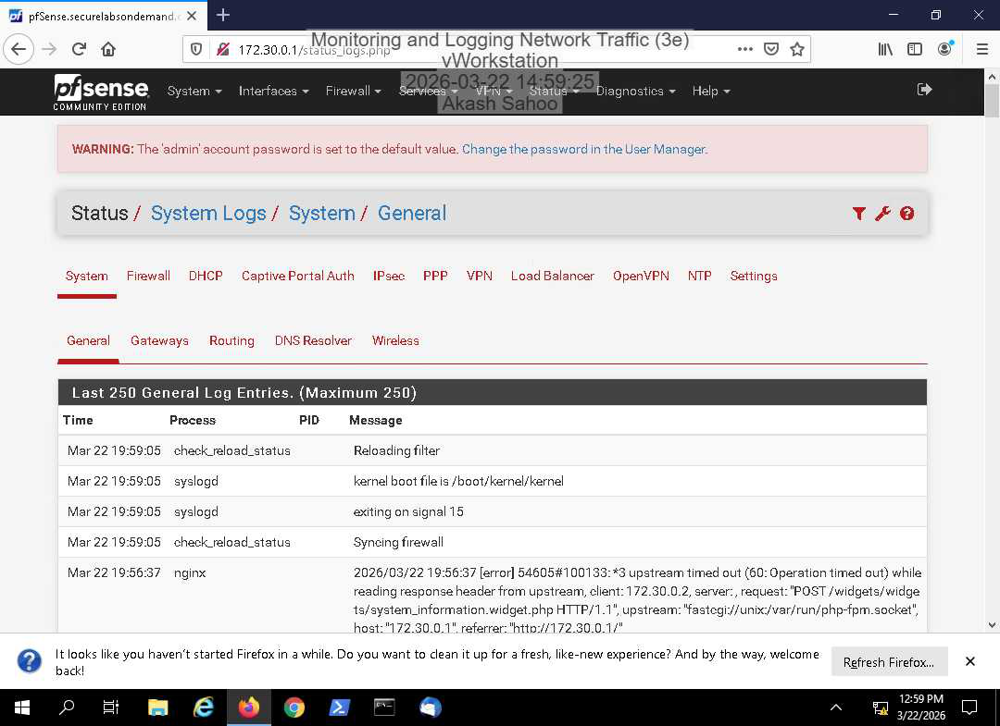
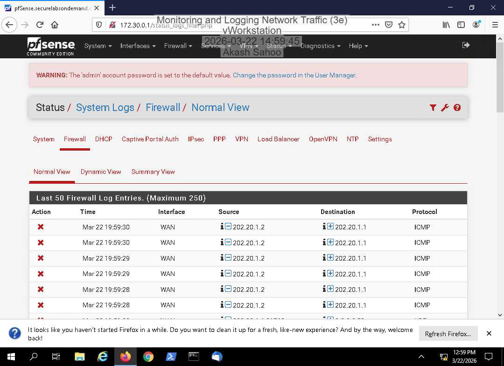
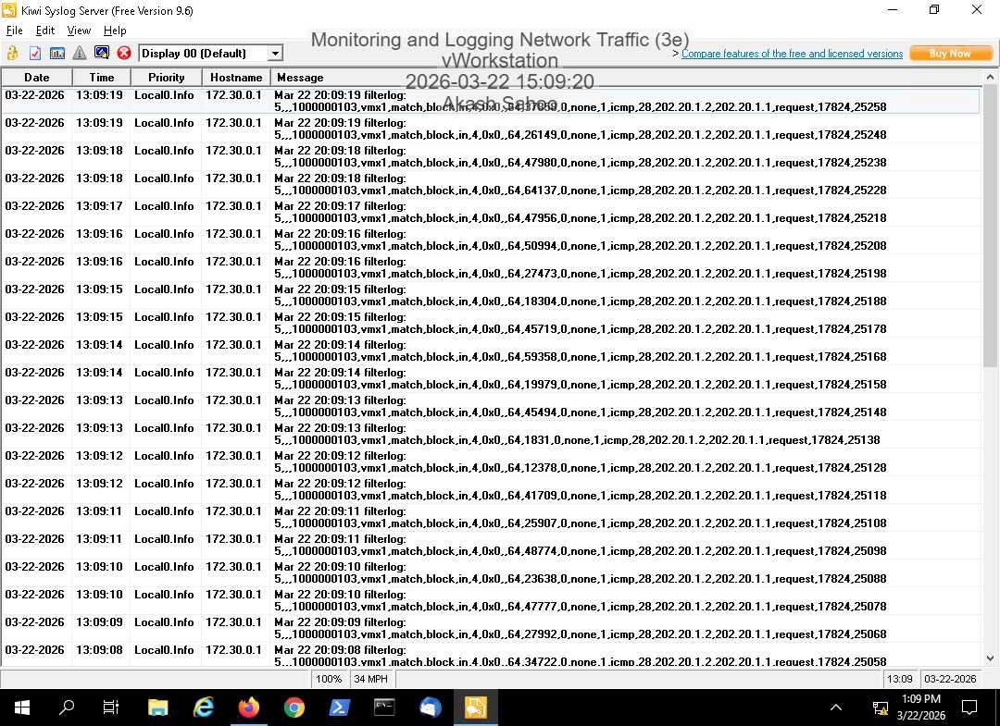

# pfSense Firewall Logging & Log Forwarding

## Project Overview
This lab focused on configuring firewall logging in pfSense, reviewing network security events, and forwarding firewall logs to a centralized syslog server.

The objective was to understand how firewall logs support network monitoring, troubleshooting, and security investigations.

## Tools & Technologies
- **pfSense:** Firewall configuration and event logging
- **Kiwi Syslog Server:** Centralized log collection and monitoring

## Lab Activities
- Examined system logs in the pfSense firewall interface.
- Reviewed firewall log entries containing network traffic information.
- Configured firewall log forwarding to Kiwi Syslog Server.
- Verified that firewall log events appeared in the centralized logging interface.

## Security Relevance
Firewall logs provide visibility into network connections and traffic handling. Security analysts can review these records to investigate unusual activity, identify potential threats, and support incident response.

Centralized log collection helps analysts monitor events from network security devices in one location.

## Key Takeaways
- Gained hands-on experience reviewing firewall and system logs.
- Practiced forwarding firewall events to a centralized logging server.
- Improved understanding of network security monitoring and log management.
- Developed foundational skills relevant to Security Analyst and SOC Analyst roles.

## Lab Evidence

### 1. pfSense System Log Monitoring

Reviewed system log entries in pfSense to examine
firewall system activity and understand how
operational events are recorded for troubleshooting
and security monitoring.

### 2. pfSense Firewall Traffic Logs

Examined firewall traffic logs in pfSense to observe
network activity and review information about
traffic processed by the firewall. These logs
provide visibility that can support network
investigations.

### 3. Centralized Logging with Kiwi Syslog Server

Configured log forwarding from pfSense to Kiwi
Syslog Server and verified that firewall events
appeared in the centralized logging interface.
This demonstrated how security events can be
collected and reviewed outside the firewall.
