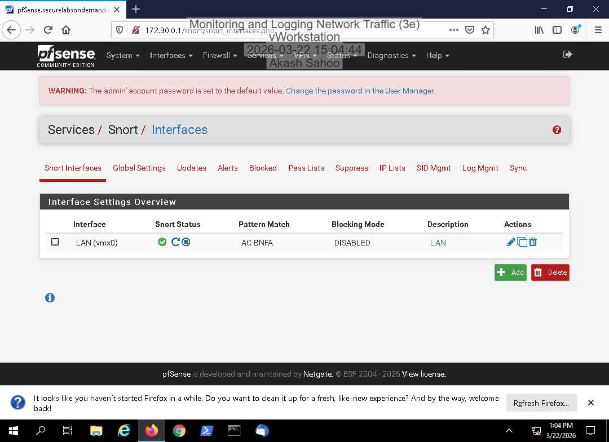
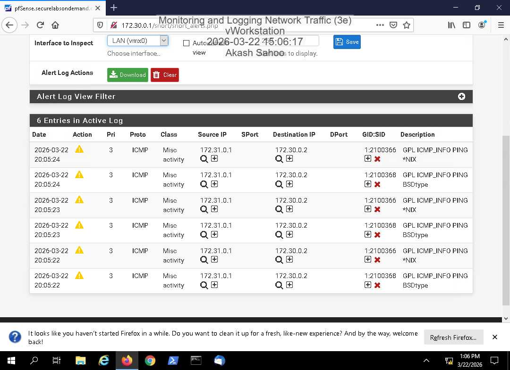
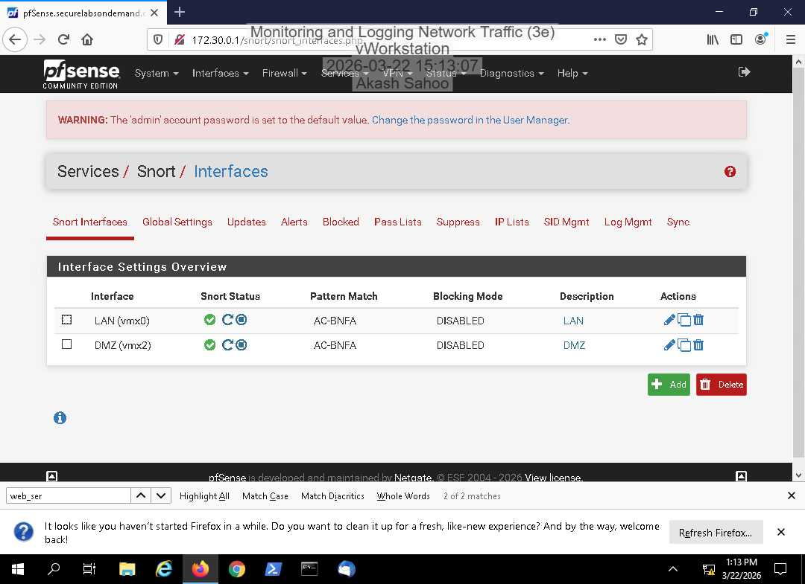

# Snort Intrusion Detection & Alert Monitoring

## Project Overview
This lab explores network intrusion detection using Snort in a pfSense environment. The activities focus on configuring intrusion detection settings, observing network traffic, and reviewing security alerts.

## Tools & Technologies
- **Snort:** Network intrusion detection and alert monitoring
- **pfSense:** Firewall and network security platform

## Lab Activities
- Explored Snort configuration within the pfSense environment.
- Reviewed intrusion detection settings and alert information.
- Observed ICMP-related network activity and associated Snort alerts.

## Security Relevance
Intrusion detection systems help security analysts identify potentially suspicious network activity. Reviewing alerts and understanding their relationship to network traffic are foundational SOC analyst skills.

## Key Takeaways
- Developed familiarity with intrusion detection configuration and monitoring.
- Practiced interpreting network security alerts.
- Improved understanding of how IDS tools support network security operations.

## Lab Evidence

### 1. Snort LAN Interface Monitoring

Configured and verified Snort intrusion detection
monitoring on the LAN interface in pfSense.
The screenshot shows the active Snort interface
status in the controlled lab environment.

### 2. ICMP Intrusion Detection Alerts

Generated ICMP traffic using a ping test and
reviewed the resulting alerts in the Snort
Active Log. This demonstrates how network
activity can be detected and recorded for
security analysis.

### 3. Snort DMZ Interface Monitoring

Configured Snort monitoring on the DMZ
interface and verified its active status.
This exercise demonstrated intrusion
detection monitoring across multiple
network segments.
