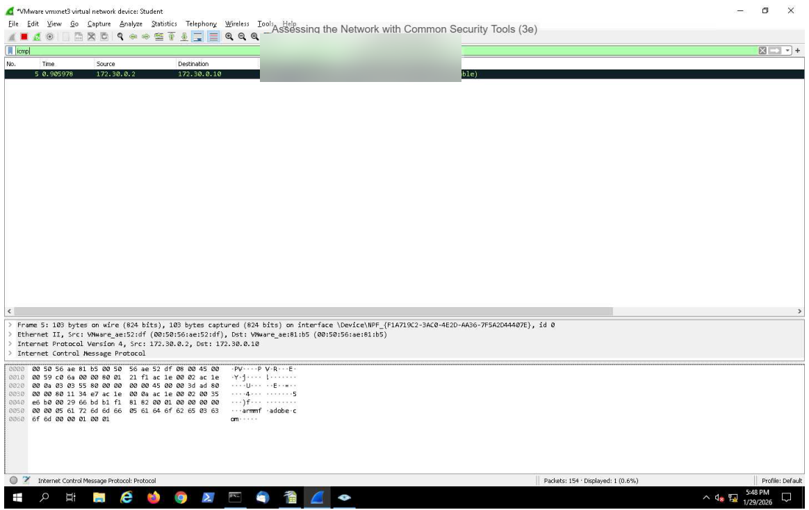
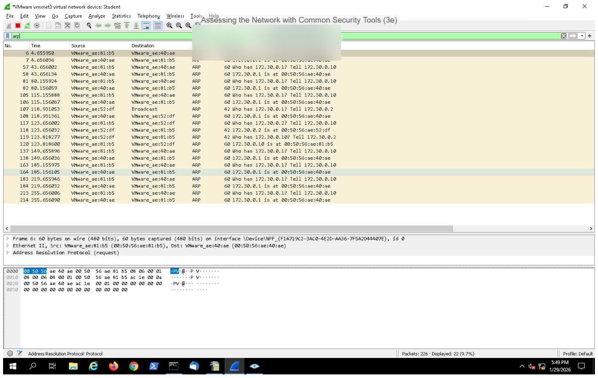

# Network Traffic Analysis with Wireshark

This section documents hands-on packet analysis exercises completed using Wireshark.

## Activities
- Examined packet headers and network protocol information.
- Analyzed source and destination IP and MAC addresses.
- Used packet filtering to inspect network traffic.

## Lab Evidence

### ICMP Traffic Analysis

Used Wireshark to filter and examine ICMP traffic,
reviewing packet information and network communication.

### ARP Traffic Analysis

Used Wireshark to examine ARP traffic and observe
how devices resolve IP addresses to MAC addresses
within a local network.

## Security Relevance

Network traffic analysis is an important part of security
monitoring and incident investigation.

- ICMP analysis helps identify network connectivity
  activity and can assist with troubleshooting.
- ARP analysis provides visibility into local network
  address resolution and can help identify unusual
  network behavior.
- Wireshark packet filtering helps security analysts
  isolate relevant traffic during network investigations.

## Key Takeaways

- Practiced examining network traffic using Wireshark.
- Improved understanding of ICMP and ARP protocols.
- Developed foundational packet analysis skills
  relevant to Security Analyst and SOC Analyst roles.
